# 🚀 AWS Blue/Green Container Delivery Platform

**Status:** Complete

**Environment:** AWS `us-east-2` (ECS/Fargate behind an Application Load Balancer)

**Focus:** AWS • Terraform • Jenkins • GitHub Actions • Docker • Amazon ECR • ECS/Fargate • Blue/Green Deployments • CloudWatch • SNS • Checkov • Trivy • OIDC

A hands-on DevOps and cloud engineering portfolio project: a production-style delivery platform that moves application code from GitHub into AWS safely, and manages the AWS infrastructure itself through a reviewed, gated pipeline. It covers automated testing, image scanning, immutable versioned artifacts, native ECS blue/green deployments, alarm-driven automatic rollback, alerting, remote Terraform state with locking, and least-privilege CI credentials with no stored AWS keys.

---

## 🏢 The Business Problem

The fictional application team has no standardized release process. Application changes need a repeatable way to move from source control into AWS without manual deployments, long-lived credentials, or blindly replacing the production workload. Infrastructure changes need review before they touch production.

The platform validates a release before production, deploys a candidate version beside the known-good version, watches its health, and reverses a failed deployment automatically before it becomes a larger incident.

---

## 🏗️ Architecture

Two independent delivery paths share one AWS environment but never trigger each other:

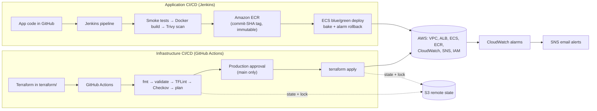

```text
Application:     GitHub → Jenkins → validate → scan → ECR → ECS Blue/Green → monitor → rollback
Infrastructure:  GitHub → GitHub Actions → Terraform plan / approval / apply → AWS
Shared auth:     GitHub OIDC → Terraform plan and apply roles (Jenkins uses its EC2 instance profile)
```

Jenkins is the only way application code reaches ECS. The project originally deployed the app with a GitHub Actions workflow; it was removed, along with its IAM role, so no second deployment path can bypass Jenkins' bake, rollback, and notification controls.

### Application delivery: Jenkins → ECR → ECS blue/green

The [Jenkinsfile](Jenkinsfile) runs on a Jenkins EC2 host whose instance profile supplies AWS access (no stored keys):

1. **Checkout** and resolve the commit SHA, which becomes the image tag.
2. **Validate Application**: install dependencies and smoke-test `/` and `/health`.
3. **Build** the Docker image and **scan** it with Trivy (fails on fixable HIGH/CRITICAL).
4. **Push to ECR**: tags are immutable, so every release is traceable to a commit.
5. **Register a task definition** based on the revision the service is running.
6. **Deploy green** with ECS's native `BLUE_GREEN` strategy: green starts beside blue, passes ALB health checks, and production traffic shifts to it.
7. **Bake for 5 minutes** with blue still running. Jenkins only probes and reports; ECS decides.
8. If a CloudWatch alarm fires during the deployment, **ECS shifts traffic back to blue automatically** and marks the deployment failed. Jenkins detects that, confirms `/health` and `/` return 200, and sends the failure notification, without issuing a second rollback.

### Infrastructure delivery: Terraform → GitHub Actions → AWS

[`.github/workflows/infrastructure.yml`](.github/workflows/infrastructure.yml) runs only when `terraform/**` (or the workflow) changes:

| Event | Jobs |
|---|---|
| Pull request | fmt → init → validate → TFLint → Checkov → **plan** (read-only role), with the plan posted as a PR comment and uploaded as an artifact |
| Push to `main` | the same checks and plan → **apply**, only after a reviewer approves the `production` environment |

Safeguards on apply:

* Runs only on `main`, only when resources change, and only when `TF_APPLY_ENABLED` is `true`.
* The `production` environment requires a reviewer and only accepts the `main` branch.
* The apply role's IAM trust only accepts GitHub OIDC tokens from that environment, so no other branch or workflow can get apply credentials.
* The apply job re-plans and refuses to continue if the changes differ from the plan that was reviewed.
* Pull requests whose plan deletes or replaces resources fail unless they carry an `allow-destroy` label.
* Sensitive inputs come from repository secrets, are marked `sensitive` in Terraform, and never appear in logs, comments, or artifacts. Binary and JSON plans, which contain them in plain text, never leave the runner.

---

## 🧠 Key Decisions & Why

* **Jenkins for applications, GitHub Actions for infrastructure.** They have different risk profiles and different owners. App releases are frequent and need deployment orchestration (bake, rollback, notifications); infrastructure changes are rarer and need review, plans, and approval. Separating them means an app change can never rebuild the VPC or load balancer, an infrastructure change never ships application code, and the infrastructure pipeline never runs on the Jenkins server it manages.
* **Native ECS blue/green with alarm-based rollback.** ECS keeps blue running through the bake window and shifts traffic back on its own if the unhealthy-target or 5XX alarm fires, so rollback does not depend on the CI server staying up.
* **Health checks alone are not enough.** A release can pass `/health` and still return errors to users. The 5XX alarm catches that during the bake, which the `http-errors` drill proves.
* **Docker + immutable commit-SHA tags.** Every running task maps to an exact commit; rollbacks are deterministic.
* **ECS/Fargate instead of Kubernetes.** Production-style container delivery without EKS operational overhead.
* **GitHub OIDC instead of permanent AWS access keys.** Workflows exchange a short-lived GitHub token for temporary STS credentials. Trust policies match the repository's immutable owner and repository IDs, so a renamed or recreated repository cannot match them.
* **Separate, least-privilege CI roles.** A read-only plan role for pull requests and a scoped apply role (us-east-2 only, this project's resource names, only four approved managed policies, no `AdministratorAccess`). Both live in a locally applied bootstrap configuration, so the pipeline cannot change its own permissions.
* **Remote state in S3 with native locking.** Versioned, encrypted, HTTPS-only, public access blocked, and locked with `use_lockfile` (no DynamoDB table).
* **CloudWatch as the operational source of truth.** Alarms drive both rollback and paging; SNS emails cover alarms and every pipeline result.
* **The application stays intentionally simple.** The project is about delivery engineering. The Flask app exists to provide versioning, health checks, and controlled failure injection.

---

## 📈 Monitoring & Alerting

| Alarm | Condition | Also triggers ECS rollback |
|---|---|---|
| `blue-green-alb-unhealthy-targets` | Unhealthy hosts ≥ 1 in either target group, 2 consecutive minutes | Yes |
| `blue-green-alb-target-5xx` | Application 5XX responses ≥ 1 in a minute | Yes |
| `blue-green-ecs-running-tasks-low` | Running tasks below the desired count, 2 consecutive minutes | No |

All three notify the `blue-green-delivery-alerts` SNS topic (email) on ALARM and on recovery. Jenkins publishes SUCCESS and FAILURE notifications to the same topic, including the ECS rollback reason and the alarm that triggered it.

---

## 🧪 Verified Failure Drills

The Jenkins `FAULT_INJECTION` parameter deploys a deliberately bad release without breaking CI:

| Drill | What breaks | Observed outcome |
|---|---|---|
| `unhealthy` | `/health` returns 500 | Green never passes health checks, so production traffic never moves. The unhealthy-targets alarm fires, ECS rolls back, and Jenkins reports the failure. No user impact. |
| `http-errors` | `/` returns 500 while `/health` passes | Traffic shifts to green; Jenkins' bake probes see 500s. The 5XX alarm fires about 2m40s after the shift (mostly CloudWatch metric delay), ECS shifts traffic back to blue within a second of the alarm, and Jenkins confirms recovery and emails the rollback reason. Blast radius: about 2m50s of errors on `/`. |

Infrastructure pipeline drills:

* **Harmless change:** a tag on the SNS topic went through PR plan → merge → apply, the tag appeared in AWS, and a new state version was written to S3.
* **State locking:** a second Terraform operation started while one held the lock failed immediately with `Error acquiring the state lock` (S3 returned 412), and the lock was released when the first finished.
* **Gated apply:** a second harmless change (a tag on the log group) waited about 3 minutes at the `production` environment until it was approved, then applied. CloudTrail shows both applies were made by the `GitHubActions-Terraform-Apply` role.
* **Invalid Terraform:** a change referencing an undeclared variable failed at `terraform validate` on its pull request, and again on `main` after it was merged by mistake. Both times plan and apply were skipped and the state in S3 was untouched. The merge was then reverted.

---

## 🧾 Evidence

| What | Where |
|---|---|
| Pull request plan with the PR comment (0 to add, 1 to change, 0 to destroy) | [PR #3](https://github.com/IvoryCloudOps/aws-blue-green-delivery-platform/pull/3) · [run 39198388873](https://github.com/IvoryCloudOps/aws-blue-green-delivery-platform/actions/runs/39198388873) |
| Checkov results (185 passed, 36 failed, report-only) | Annotations and job summary on any [Infrastructure run](https://github.com/IvoryCloudOps/aws-blue-green-delivery-platform/actions/workflows/infrastructure.yml) |
| Approval gate: apply waited for review, was approved, then applied | [run 39200644589](https://github.com/IvoryCloudOps/aws-blue-green-delivery-platform/actions/runs/39200644589) |
| Invalid Terraform blocked at validate on a PR and on `main` | [PR #5](https://github.com/IvoryCloudOps/aws-blue-green-delivery-platform/pull/5) · [run 39200829591](https://github.com/IvoryCloudOps/aws-blue-green-delivery-platform/actions/runs/39200829591) |
| Remote state | `s3://blue-green-delivery-tfstate-075723833258/blue-green-delivery/terraform.tfstate`, a new object version per apply |

GitHub keeps workflow logs for 90 days and plan artifacts for 30, so the screenshots below are the durable record.

<details>
<summary><b>Screenshots</b></summary>

**Infrastructure pipeline**

| | |
|---|---|
| Pull request plan comment | 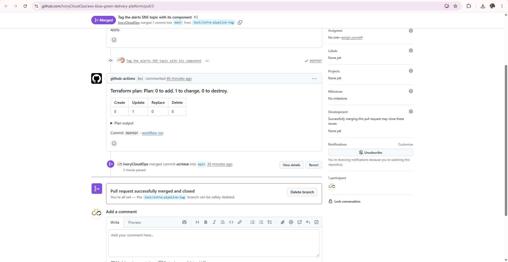 |
| Pull request checks | 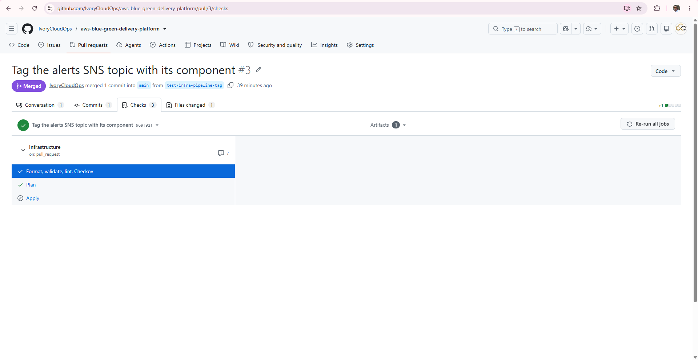 |
| Checkov and plan summary | 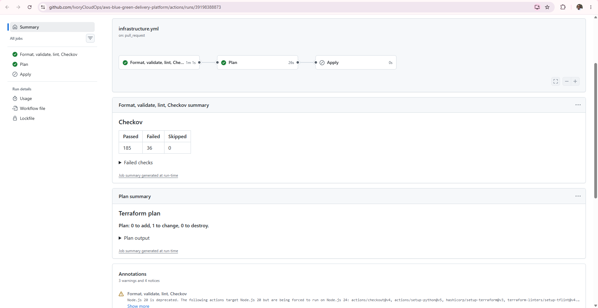 |
| Production approval and apply | 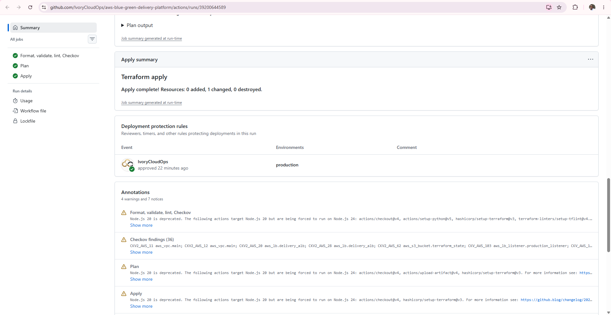 |
| Apply annotations and plan artifact | 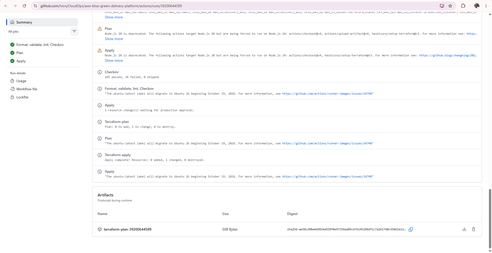 |
| `production` environment protection | 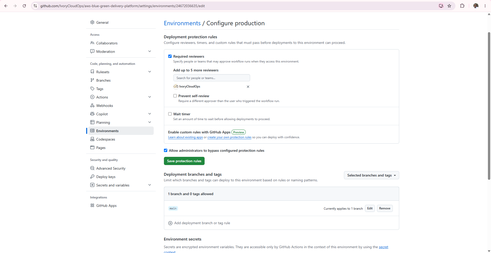 |
| S3 remote state versions | 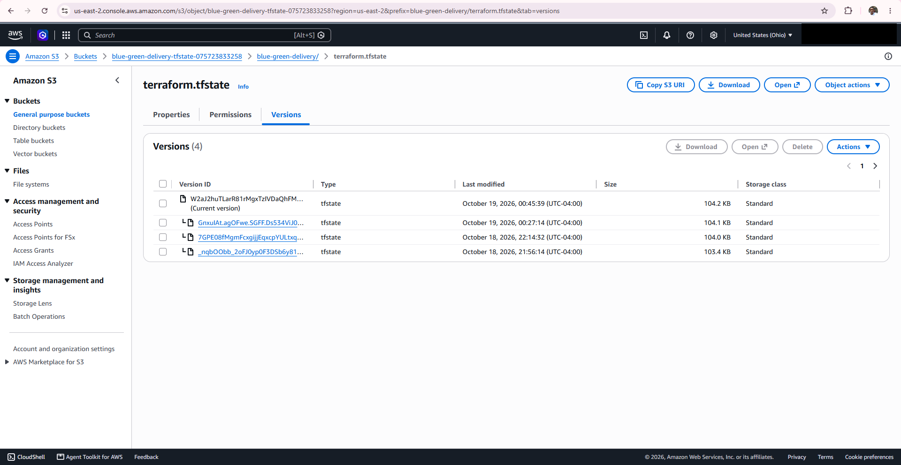 |
| Change applied in AWS (SNS tags) | 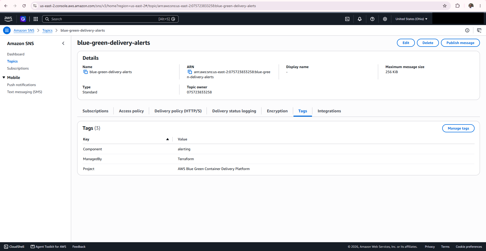 |
| Invalid Terraform blocked before plan and apply | 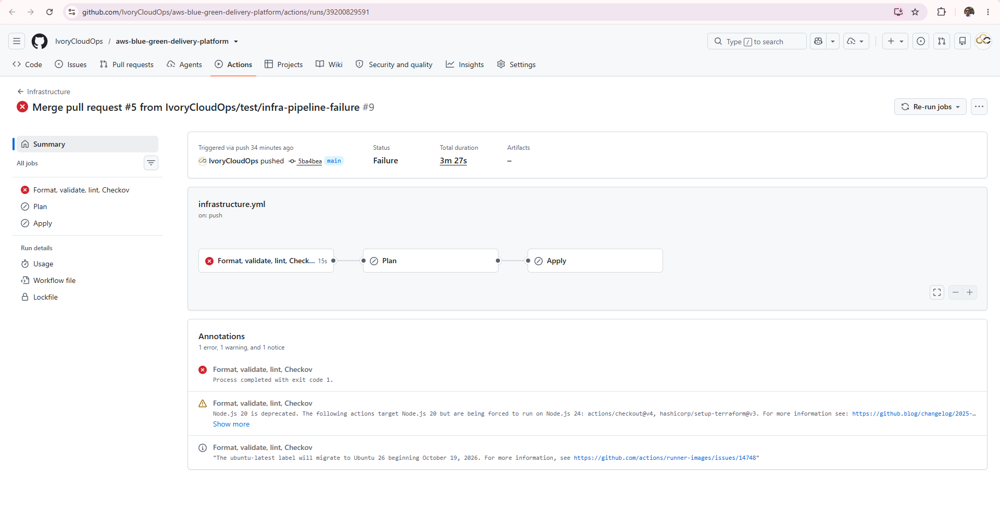 |

**Application pipeline and monitoring**

| | |
|---|---|
| Successful Jenkins deployment | 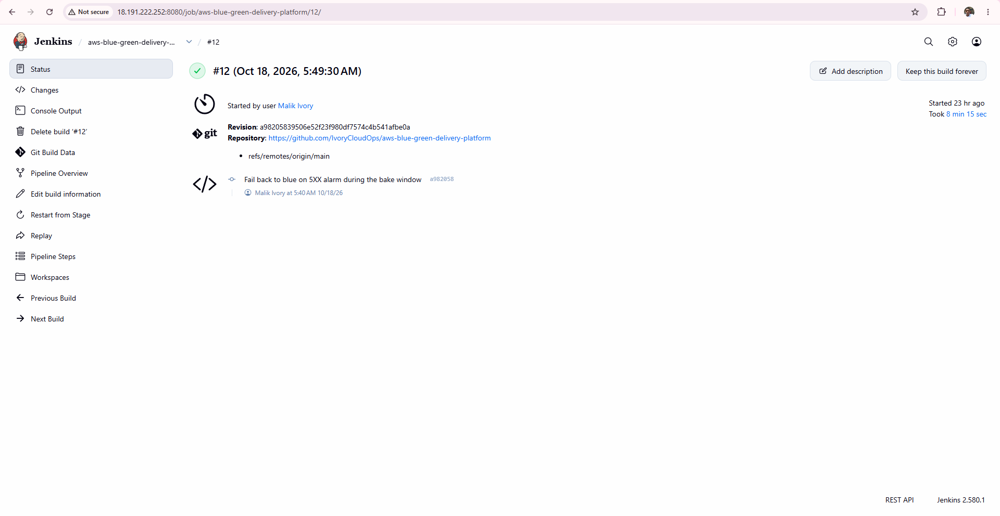 |
| Rollback notification from the `http-errors` drill | 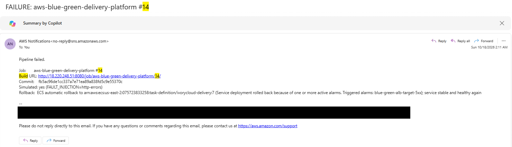 |
| CloudWatch alarms | 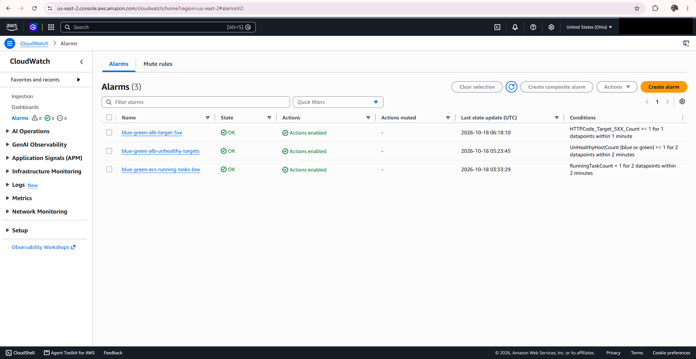 |

</details>

---

## 🔒 Security Notes

* No AWS access keys are stored in GitHub or in the repository; every pipeline uses OIDC or an instance profile.
* No Terraform state, tfvars, or plan files are committed. State lives only in S3.
* The Jenkins UI is reachable only from one allowed CIDR, and the host is managed through SSM Session Manager (no SSH port).
* Checkov runs on every infrastructure change. It currently reports findings without blocking (185 passed, 36 failed at the time of writing); specific checks can be enforced through `CHECKOV_HARD_FAIL_ON` in the workflow.

---

## 🗂️ Repository Layout

```text
app/                                  Flask app, Dockerfile, requirements
Jenkinsfile                           Application pipeline (build, scan, deploy, bake, rollback, notify)
terraform/                            Main infrastructure (VPC, ALB, ECS, ECR, IAM, Jenkins EC2, alarms, SNS)
terraform/bootstrap/                  State bucket and CI roles, applied locally by an administrator
.github/workflows/infrastructure.yml  Infrastructure CI/CD
.github/actions/terraform-setup/      Shared setup: secrets check, Terraform, OIDC credentials, S3 init
```

---

## 🚀 What I'd Do Differently at Production Scale

* **Separate AWS accounts** for development, staging, and production, with the apply role per account.
* **IAM permissions boundaries** on project roles. The apply role can still write inline policies on `blue-green-*` roles; a boundary would cap what those roles could ever be granted.
* **Enforce Checkov** on a triaged set of checks, and fix the accepted demo trade-offs (HTTPS on the ALB, ALB access logs, KMS encryption for logs and SNS, tighter security group egress).
* **Ephemeral Jenkins agents** (or a managed CI service for application builds) instead of a single long-lived EC2 host.
* **A test listener** so green is exercised with real requests before any production traffic shifts, plus container-level health checks.
* **Longer bake windows** to keep a wide margin over CloudWatch's metric delay.
* **Expanded observability** with tracing, SLO-based alerting, and dashboards.
